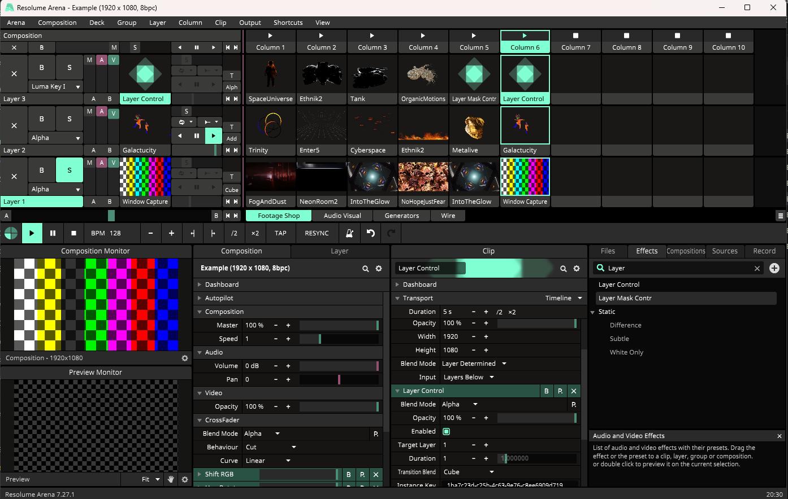

# ResolumeLayerControl

An FFGL plugin for controlling a layer's Transition Blend Mode, Duration, and Mask Mode using an Effect Clip.

## Setup

### Download DLL

⬇️ [Download the latest release](https://github.com/zukio/ResolumeLayerControl/releases/)

### Use in Resolume

1️⃣ Copy `LayerControl.dll` to `Documents\Resolume Arena\Extra Effects`.  
2️⃣ Start or restart Resolume Arena,  
3️⃣ Enable **Preferences > Webserver**. Keep Webserver enabled while using the plugin.  
4️⃣ Add **Layer Control** to an Effect Clip from the Effects tab.  
5️⃣ Leave **Enabled** on and trigger the Clip's Column.

## APISender

[APISender](docs/APISender.md) sends user-entered WebSocket JSON when its Effect Clip becomes active or inactive. It is a separate plugin with Active Command and Inactive Command text parameters; no Target Layer or automatic baseline restoration. Build target: `ffgl-plugin-api-sender`. Host validation is pending.

## Build

See [Build and setup](docs/SETUP.md) for the current Layer Control, Layer Mask Control, and APISender build and installation instructions.

## Dependency

The official Resolume FFGL SDK is vendored under `third_party\ffgl` from <https://github.com/resolume/ffgl>.
